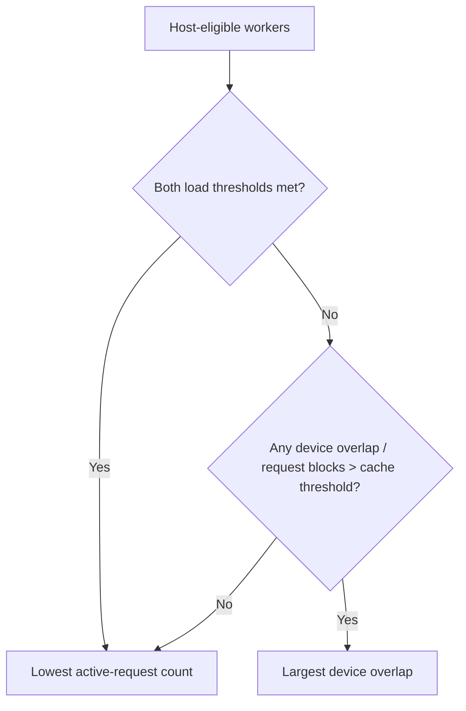

# SGLang cache-aware policy

`sglang-cache-aware-dynamo-policy` implements SGLang Model Gateway's cache-aware selection policy as a Dynamo worker-selection-policy catalog.

## Algorithm

For every already eligible worker `i`, the picker reads the following Dynamo signals:

| Symbol | Dynamo input | Meaning |
| --- | --- | --- |
| `R` | request blocks | Blocks in the incoming prompt |
| `Oᵢ` | device overlap blocks | Request blocks resident in worker `i`'s device KV cache |
| `Qᵢ` | active requests | Router-tracked in-flight request count |

1. Let `Qmin` and `Qmax` be the minimum and maximum `Qᵢ` across Dynamo host-eligible workers.
2. The pool is imbalanced only when both strict predicates hold: `Qmax - Qmin > balance_abs_threshold` and `Qmax > balance_rel_threshold × Qmin`.
3. When imbalanced, choose the least-loaded worker and ignore cache affinity.
4. Otherwise, a worker cache-qualifies when `R > 0` and `Oᵢ / R > cache_threshold`. Choose the qualifying worker with the largest device overlap.
5. If no worker cache-qualifies, choose the least-loaded worker.

Exact ties use Dynamo's stable worker/rank key. SGLang randomizes ties, but candidate row order is deliberately unspecified in Dynamo, so deterministic ties keep replicas consistent.



This is an intentional semantic upgrade over a byte-for-byte SGLang port: SGLang uses an approximate character-prefix history tree, while Dynamo reads authoritative device-KV overlap. It does not add Dynamo core APIs or maintain a duplicate prefix tree.

## Configuration

[`worker-selection.yaml`](worker-selection.yaml) configures the policy for aggregated, prefill, and decode pools.

| Parameter | Default | Meaning |
| --- | ---: | --- |
| `cache_threshold` | `0.3` | Strict device-cache fraction required for affinity |
| `balance_abs_threshold` | `64` | Strict active-request gap needed before cache bypass |
| `balance_rel_threshold` | `1.5` | Strict active-request ratio needed before cache bypass |
| `kv_fetch_min_blocks` | unset | Experimental. Skip the router's KV fetch hint when the fetch adds fewer blocks than this. See [KV fetch gate](#experimental-kv-fetch-gate) |

`active_requests` comes from Dynamo reservation lifecycle accounting. A deployment must preserve normal admission, completion, and cancellation events for the load gate to remain meaningful.

## Experimental KV Fetch Gate

When workers consume KV hints, Dynamo attaches a `kv.fetch` hint to a booked selection if another worker holds a longer cached prefix than the selected worker. The selected worker then fetches that prefix before prefill. The load gate is where this matters, because it moves a request away from the worker that holds its prefix.

`kv_fetch_min_blocks` skips the fetch when it adds fewer KV blocks than the configured minimum, counted beyond the selected worker's own cached prefix. When it is unset, the policy attaches no fetch policy and Dynamo's default fetch behavior is unchanged. A value above any prompt length, such as `4294967295`, skips every fetch.

The gate uses Dynamo's experimental `plugins::worker_selection::experimental::kv_hints` API, which has no compatibility guarantee. Until [ai-dynamo/dynamo#15599](https://github.com/ai-dynamo/dynamo/pull/15599) merges, this crate pins `dynamo-kv-router` to that PR's head, so a Dynamo build that links this catalog needs that branch.

### A/B Results

These results were measured in Dynamo PR #15599 with the same gate on Dynamo's built-in `dynamo-two-tier-cost-fn` policy, which runs the same load-gated algorithm. Disabling fetch there matches setting `kv_fetch_min_blocks` above any prompt length here. Fetch enabled matches leaving it unset.

- Setup: one host with 8x H100, one vLLM worker per GPU with KVCR, and Qwen3-32B-FP8. The fetch-enabled run used KVCR over RDMA.
- Load: a 15-minute agent-loadgen `swe-bench` run per setting, about 4,450 requests each.
- A moved turn is a session turn that the policy sends to a different worker than the session's previous turn. This happened on 2-3% of requests.

| Fetch | Moved turns | Moved-turn TTFT, median / p90 | Moved prompt tokens served from cache |
| --- | ---: | --- | ---: |
| Disabled | 101 | 1,322 / 6,232 ms | 11% |
| Enabled | 150 | 728 / 1,573 ms | 91% |

For moved turns with more than 32k prompt tokens, the median took 8.4 s without fetch and 1.5 s with it. Each setting was run once. The fetch-disabled run had a 28 GiB CPU tier instead of 32 GiB, which affects reuse on turns that stay on the same worker but not recompute on moved turns.

## Run with Dynamo Mockers

Build Dynamo against this catalog crate by replacing the empty catalog dependency in `/path/to/dynamo/lib/bindings/python/Cargo.toml`:

```toml
# dynamo-worker-selection-policy-catalog = { path = "../../router-plugins/catalog", optional = true }
dynamo-worker-selection-policy-catalog = { package = "sglang-cache-aware-dynamo-policy", path = "/path/to/router-sandbox/crates/sglang-cache-aware", optional = true }
```

```bash
cd /path/to/dynamo/lib/bindings/python
CARGO_TARGET_DIR=/path/to/dynamo/target maturin develop --uv --features custom-policy
```

Start the KV frontend and two Mockers with the same file-store namespace. `model_path` must be a local directory containing the model tokenizer (the mocker does not require model weights):

```bash
export DYN_FILE_KV="$(mktemp -d)"
export DYN_NAMESPACE=sglang-cache-aware-mocker
export MODEL_DIR=/path/to/Qwen2.5-0.5B-Instruct

python -m dynamo.frontend --router-mode kv \
  --router-policy-config /path/to/router-sandbox/crates/sglang-cache-aware/worker-selection.yaml \
  --model-path "$MODEL_DIR" --model-name Qwen/Qwen2.5-0.5B-Instruct \
  --discovery-backend file --request-plane tcp --event-plane zmq \
  --router-min-initial-workers 2

python -m dynamo.mocker --router-mode kv --model-path "$MODEL_DIR" \
  --model-name Qwen/Qwen2.5-0.5B-Instruct --discovery-backend file \
  --request-plane tcp --event-plane zmq --num-workers 2 --speedup-ratio 0
```

## Validation

```bash
cargo test -p sglang-cache-aware-dynamo-policy
cargo clippy -p sglang-cache-aware-dynamo-policy -- -D warnings
cargo fmt --check
```
